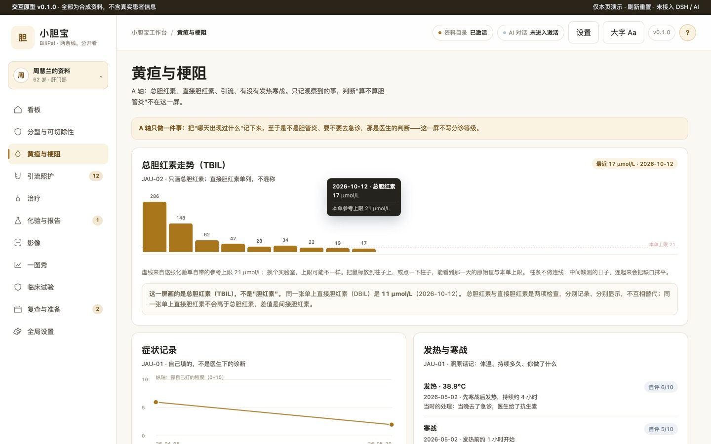
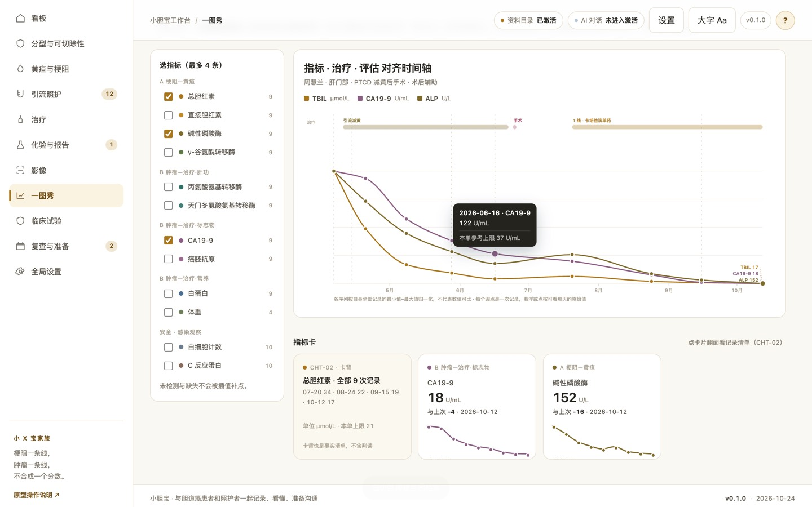
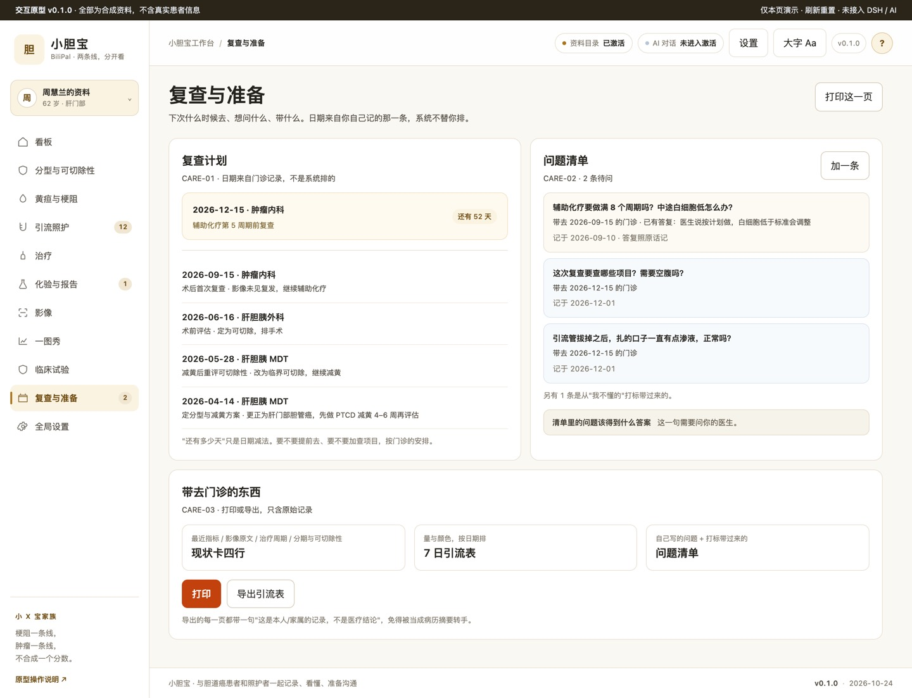
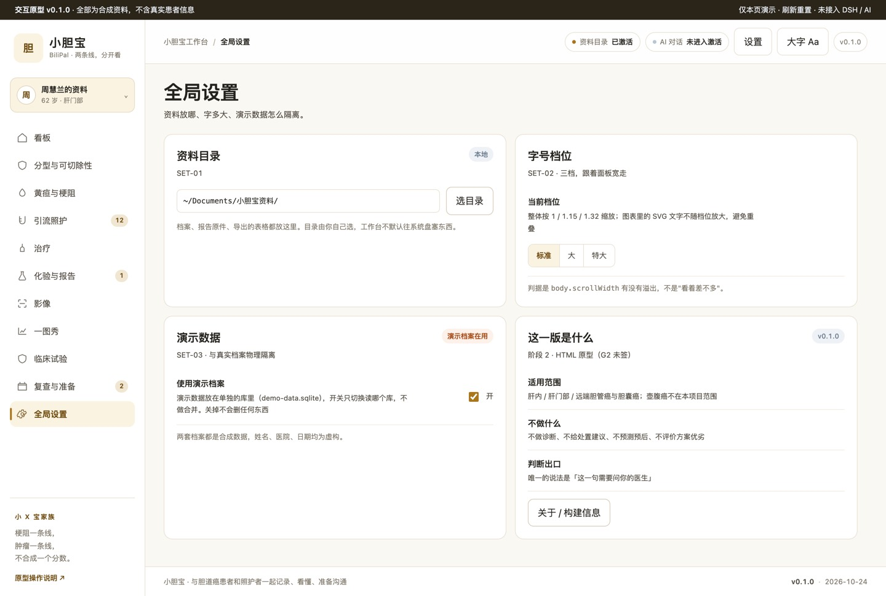

# 小胆宝 · 胆道癌工作台

面向胆道癌（胆囊癌 / 肝内胆管癌 / 肝门部胆管癌 / 远端胆管癌）患者与照护者，**跑在本机**的工作台：分型与可切除性、黄疸与胆道引流、治疗线序、复查准备，按「谁在什么时候说过什么」记下来。

它不诊断，不推荐方案，不判断能不能手术，也不代表任何入组资格。这几件事只有你的医生能回答。

---

## 这是什么

说白一点：一个记账本。记报告、记门诊里医生说的话、记每天引流多少，按日期排好，不替你算出一个「结论」。

它干的三件事都很具体。散在各处的报告和门诊记录收到一处，按时间排——换过医院也找得回来。医生说过的话留痕：谁说的、哪天、原话要点；被更正的旧说法也留着，不删。到了该问问题的时候提醒你一句，提醒只看你自己记的日期（距上次复查多少天、这根管子用了几天），不看病情。

至于它不做什么，看表更省事：

| 不是 | 原因 |
|---|---|
| 诊断工具 | 不做分期、不做分级、不给「现在怎么样」 |
| 方案推荐器 | 不排线序、不写「首选/建议/应该」 |
| 手术可行性判断 | 只记录某人在某天说了可切除 / 不可切除 |
| 临床试验入组评估 | 只做条件三态对照，符合度只会偏低、不会偏高 |
| 病历替代品 | 不替代医院记录，也不往医院系统写任何东西 |

这些不是客气话。11 条医学口径（M1–M13）每次提交都跑 `npm run check:medical`，文案里出现「稳定」「建议」「应该」，检查就红。边界是脚本守着的。

## 谁适合用

**适合**

- **刚确诊两周的人**。报告上「胆管细胞癌」「肝门部占位」「考虑胆道来源」混着出现，最想弄清的是这几个词到底是不是一回事。
- **带管回家的**。PTCD、ENBD、支架，一天一记引流量；夜里烧到 37.8℃，想知道该不该打电话（本台只给一句「请联系你的医疗团队」）。
- **每三个月复查的**。十几份报告来自不同医院，攒了半年，回头看不知道这半年是怎么走的。
- **替家人记的家属**。老人说不清，总得有个人把日期、数值、原话记准，门诊时直接递过去。
- **病友群里的志愿者**。同样的问题被私聊问过几十遍，想整理成一份清单。

**不太适合**

- 想让它告诉你「该不该做手术、该用哪个方案、能不能入组」的。它一句都不会说，你会觉得它没用。
- 想要自动读报告、自动填表的。目前所有数据都得手动录。
- 需要多人在线协作的。本机优先，数据就在这台机器上，没有云同步。

> 本台面向患者与照护者，不面向医生做临床决策支持；也不做医院、医生、方案的排名。

## 主要功能

十个页面，一页一句话。右边是原型里的页名，想对着截图看就往下翻到「功能展现」。

| 功能 | 一句话说明 | 页面 |
|---|---|---|
| 看板 | 四行事实 + 梗阻—黄疸 / 肿瘤—治疗两条线并列 + 四条来自你自己日期的提醒 | `dash` |
| 分型与可切除性 | 分型是解剖位置，可切除性是「某人某天说的」，分开放，被更正的留痕不删 | `type` |
| 黄疸与梗阻 | 胆红素柱条不连线（缺测不填平），本单参考上限画虚线，症状折线只连同种症状 | `jaundice` |
| 引流照护 | 管子拆成置入/换管/拔除三条事件，每日量用柱条，观察项只写体温与当时的处理 | `drain` |
| 治疗线序 | 每条带开始日期、方案原文、依据三栏（医生原话 / 当时看的指标带日期与倍数 / 指南条目） | `treat` |
| 化验与报告 | 参考上限只取本单；报告只索引原文首行不解读；「我不懂的」打标只转成问题不给答案 | `labs` |
| 影像 | 每次影像一段，「谁报的」单列一行；没有原件的那次直接写「报告清单里没有这一天的原件」 | `imaging` |
| 一图秀 | 最多 4 条序列归一化折线 + 治疗色带 + 评估竖线，每个数据点可悬浮看当天原值 | `chart` |
| 临床试验 | 8 项病理特点带日期与来源 → 逐条三态对照；符合度 = 符合项 ÷ 已对照项 | `trials` |
| 复查与准备 | 「还有多少天」只是日期减法；问题清单照原话记；导出页固定声明「不是医疗结论」 | `care` |

## 能解决哪些患者痛点

痛点是从「患者在哪一刻最难受」往回推的，不是从门诊流程抄的。编号 U1–U6 是**用户假设**，核到什么程度就写什么程度：

| 痛点（患者那一刻的原话） | 现在的难受在哪 | 本台的处理 | 本台不做 | 核实状态 |
|---|---|---|---|---|
| U1「报告上四个词，是不是一回事？」 | 分型名词混用，不知道该信哪个 | 分型卡把报告词对应到四种分型之一，每型写「这个词通常指什么」 | 不判分期、不判恶性程度 | **未经访谈核实** |
| U2「这算不算要马上回医院？」 | 夜里引流量减半、低烧，不敢打扰医生又怕耽误 | 观察项表 + 当日记录，每项只写「出现这些情况请联系你的医疗团队」 | 不写处置、不分诊、不写「危险」 | **未经访谈核实** |
| U3「医生说了能切，条件是什么？」 | 记住结论忘了条件，家属之间说法不一致 | 三条记录位：谁说的 / 哪天 / 原话要点 | 不自动判定可切除性 | **未经访谈核实** |
| U4「门诊 10 分钟，出来才想起三个问题」 | 想问的没问，下次又是三个月后 | 就诊准备清单（可勾选、可自己加），导出纯文本带去门诊 | 不替你决定问什么更重要 | **未经访谈核实** |
| U5「不懂指南，也不知道医生为什么这么定」 | 方案依据听不懂，只能记住「先用这个」 | 方案依据三栏：医生原话 + 当时指标（带日期与倍数）+ 指南条目（机构/版本/页码缺一即「未引入」） | 不解释指南、不判断依据是否充分 | **n=1 非正式输入**（2026-10-24） |
| U6「太多不同的检测报告看不懂，病情到底怎么样了」 | 十几份报告散在各处，越看越慌 | 现状卡只列四行事实 + 报告清单按时间排 + 「我不懂的」打标 | 不写「目前病情稳定」这类判断 | **n=1 非正式输入**（2026-10-24） |

「核实状态」这一列是故意留着的：U1–U4 到现在没做过一次正式访谈。真实痛点比这张表细，这也是第一版最需要人搭手的地方。

## 功能展现（20 屏 / 27 张）

截图都是实机跑的（Chrome 145，1440×900），点开看原尺寸。原型不接 DSH、不落库、没有 AI——刷新就重置。逐条走查的进度在 [G2 确认表](docs/G2-CONFIRM-SHEET.md)，证据和限制在 [原型证据](docs/PROTOTYPE-EVIDENCE.md)。

三句话先说清这一版在做什么：**只记事实**（值 / 日期 / 谁说的）、**不生成判断**（「现在怎么样」一处都没有）、**两轴并列不加总**（梗阻—黄疸 与 肿瘤—治疗 分开看）。

### 看板
四行事实 + 两条线并列 + 四条提醒（都来自你自己记的日期）。

 

*左：p1 周慧兰（带 PTCD，A 轴三格有值）；右：p2 郭长林（无引流，A 轴写「无记录」而不是 0）。*

### 分型与可切除性
分型是解剖位置，可切除性是某人在某个日期说的——两件事常被当成一件，所以分开放；被更正的旧结论留痕不删。


### 黄疸与梗阻
胆红素柱条不连线（缺测的日子不被填平），本单参考上限画成虚线；症状折线只连同一种症状自己的记录；「检查项目说明」折叠起来，因为库里没有带页码的原件。悬浮或点按任意柱子，能看到那一天的原始值与本单上限。

 

*右：气泡显示「2026-10-12 · 总胆红素 / 17 μmol/L / 本单参考上限 21 μmol/L」。*

### 引流照护
管子拆成置入 / 换管 / 拔除三条事件；每日量用柱条；观察项只写体温与当时的处理。

 

*左：p1 有管；右：p2 没有胆道引流记录——显示一句说明，而不是一张空表。*

### 治疗：线序 / 方案依据 / 检测位点
当前进度（计划 8 / 已完成 4）；方案依据三栏（医生原话 / 当时看的指标带日期与倍数 / 指南条目）；检测位点三态，`KRAS` 显示「未检测」而不是阴性。


 


### 化验与报告：值 / 报告 / 我不懂的
参考上限只取本单；缺上限显示「需参考上限」且倍数留空；报告只索引原文首行、不解读；打标只转成问题，不给答案。


 


### 影像
每次影像一段，「谁报的」单列一行；没有原件的那次直接写「报告清单里没有这一天的原件」。


### 一图秀
三序列归一化折线 + 治疗色带 + 评估竖线；每个数据点都画出来，悬浮或点按看那天的原始值与本单上限；指标卡可翻面看记录清单；同时画的上限 4 条。

 


*右上：气泡显示「2026-06-16 · CA19-9 / 122 U/mL / 本单参考上限 37 U/mL」。*

### 临床试验：匹配 / 检索 / 收藏与跟踪
8 项病理特点带日期与来源 → 逐条三态对照；符合度 = 符合项 ÷ 已对照项，**未知项按 0 计，所以只会偏低、不会偏高**；硬性不满足单独折叠；**这不是入组资格，也不代表效果**。10 条全为合成数据。

 
 
 

*末两张：收藏后的状态与外部变化时间线。*

### 复查与准备
「还有多少天」只是日期减法；问题清单里已答复的照原话记；导出页固定声明「不是医疗结论」。



### 全局设置
资料目录、三档字号、演示数据开关（与真实档案物理隔离，关掉不删东西）。



> 截图源文件在 `prototypes/_evidence/*.png`（27 张，可用 `npm run probe:proto` 重跑重现，不入库）；README 用的是压缩副本 `docs/screenshots/*.jpg`（1440 宽、7.2 MB）。27 张全部在下面按页面分组嵌入，没有一张只躺在目录里。

## 疾病概要

看板右上角的「?」能展开同一份内容（数据源 `prototypes/v0.2/primer-data.js`）。四段只做公开信息的整理，不是对任何一份档案的判断。

### 定义

胆道癌是发生在胆道系统的一组恶性肿瘤的统称。本项目按解剖部位分成四类记录：肝内胆管癌、肝门部胆管癌、远端胆管癌与胆囊癌；同一个「胆道癌」下面，部位不同，手术方式、引流路径与随访安排都不同。肝门部按 Bismuth-Corlette 分型记录（演示档案为 IIIb），这是医生写下的分型原文，本台不改写。项目明确「可切除性判断随影像与黄疸处理动态变化」，工作台只记录谁在什么时候说了可切除 / 不可切除，不自己判断。梗阻—黄疸与肿瘤—治疗两条线并行，刻意不合成一个分数。

**来源**：NCCN · NCCN Guidelines · Biliary Tract Cancers（2.2025，据本项目 docs/SPEC.md 记录）· 未取得原件，据二次来源 · 页码待核 ｜ 本项目 · docs/SPEC.md 与 docs/PROTOTYPE-EVIDENCE.md · 2026-10-24 版 · 项目文档

### 医学资料规范和指南情况

| 机构 | 文件 | 版本 / 年份 | 原件 | 本台的用途 |
|---|---|---|---|---|
| NCCN | NCCN Guidelines · Biliary Tract Cancers | 2.2025（据 docs/SPEC.md，生效日未核实） | 未取得原件 | 病种范围与治疗路径的并列参照；条目级引用待补，页码待核 |
| CSCO | CSCO 胆道系统肿瘤指南 | 版本未核实 | 未取得原件 | 国内可及药物与本土实践差异；本版暂不作引用依据 |
| AJCC | Cancer Staging Manual, 8th ed. | 第 8 版（出版年份未核实） | 未取得原件 | 试验入组条件里的分期口径（演示数据写作「AJCC 第 8 版」）；本台不生成分期 |

- `docs/DEV-REQUIREMENTS-2026-10-24.md` 的 M8 定下规矩：缺少机构、版本、页码任一项，整条不显示，界面写「未引入」。这张表只说明文件存在与版本记录，不引用具体条文。
- CSCO 的版本号在项目文档里没有记录，本表写「版本未核实」，不按印象补一个年份。

**来源**：见上表逐行。

### 目前治疗全景概要

本项目尚未取得带页码的指南原件，所以这一段列的是「项目档案与试验页里出现过的治疗段落」，不是指南清单的完整枚举，也不是给你排的先后顺序。

- 减黄与胆道引流：PTCD 外引流、ENBD 与胆道支架，项目文档把它们并列为带管生活的三种情形；选哪种由介入或内镜团队决定。
- 手术切除：演示档案写法为「右半肝 + 尾状叶切除 + 肝外胆管切除 + 胆肠吻合」，胆囊癌为「胆囊癌根治术（胆囊床切除 + 肝十二指肠韧带淋巴结清扫）」；切缘与淋巴结按病理原文照抄。
- 术后辅助治疗：演示档案记录为卡培他滨单药、按周期记录；是否做、做几个周期由肿瘤内科决定。
- 晚期 / 不可切除后的系统治疗：按线序记录，每条带开始日期、方案原文与依据三栏；试验库按「分型 × 位点 × 治疗线数」列条件（FGFR2 融合、IDH1 R132、HER2、MSI-H、KRAS 等），只做三态对照，不排优先级。
- 贯穿全程：梗阻—黄疸线与肿瘤—治疗线分开记录；复查按主诊医嘱记录。

> 以上是文献与指南里列出的手段，按病期与线序排列，不代表任何一项适合你。选哪一个，这一句需要问你的医生。

**来源**：NCCN · NCCN Guidelines · Biliary Tract Cancers（2.2025，未取得原件，条目级引用待补）· 页码待核 ｜ 本项目 · prototypes/v0.2/demo-data.js 与 docs/SPEC.md · 2026-10-24 · 项目文档

### 发展趋势

只写已发生的事实，每条带日期或版本号。

1. 2025 年：本项目文档记录的 NCCN 胆道癌指南版本为 2.2025（docs/SPEC.md）；原件未取得，生效日期与此前版本的版本号未核实。
2. 截至 2026-10-25：CSCO 胆道系统肿瘤指南在项目文档里只登记了「存在」，版本号与年份未核实。
3. 截至 2026-10-25：本台未对胆道癌的登记平台做专项检索，在研登记数量与阶段分布未整理。
4. 分期体系：项目试验入组条件使用 AJCC 第 8 版；第 7 版何时被取代、是否有更新版本，本台未核实。

**来源**：NCCN · Biliary Tract Cancers（2.2025，据 docs/SPEC.md）· 未取得原件 · 页码待核 ｜ 本项目 · docs/SPEC.md · 2026-10-24 版 · 项目文档

## 当前状态：还是原型，不是能用的工作台

说清楚，免得你装完失望。

`dsh/` 和 `lib/` 里目前只有注册骨架：注册、健康接口、版本展示、大字开关。G2 逐条确认过之前，业务逻辑一行都不写。

那 20 屏是 HTML 交互原型。能真点、能悬浮、能翻面，但它不接 DSH、不落库、没有 AI，刷新就回到起点。

演示数据全是合成的。`demo/` 里两套虚构档案（肝门部 pCC 减黄后手术、胆囊癌术后影像复发）加 10 条 `DEMO-` 前缀的合成试验，只用来走查和验证库结构。

闸口进度：G1 已签，G2 **11/56**（按 ACC 号一条条走），G3 的数据模型还没签。逐条记录在 [G2 确认表](docs/G2-CONFIRM-SHEET.md)。

## 第一版不完美，需要懂这个病的人一起改

这一版能跑通骨架，也能让你看见边界在哪。离成品还远。

最要紧的短板是痛点本身没核实。U1–U4 至今没做过一次正式访谈，全是我从「哪一刻最难受」往回推的；U5、U6 只有一条非正式输入（n=1）。如果你本人或家人走过这条流程，一句「其实当时最卡的是 X」，可能就把整页的重心挪了。

第二件，指南条目进不来。手上没有带机构、版本、页码的原件，界面就只能写「未引入」。那是规则在起作用，不是没做完。有能引用的原件，补进去，三处空白就变成内容。

分型的边界也粗。肝门部和远端、iCCA 和 pCCA，真实病例里会打架。本台现在只记录医生写的原文，不做任何归并。

还有一个绕不过去的：没有任何真实病例跑过。演示档案是合成的，真实报告的长尾——外院模板、手写、单位不统一——一定会打脸。

只做了中文、只做了本机。云同步、多设备、打印排版，一样没有。

**需要什么样的贡献**

- **熟悉胆道癌的开发者、有临床背景的同学**。这一类最缺。知道 pCCA 和 dCCA 在引流路径上的差别，才判断得出哪一栏该拆、哪句话已经越界。
- **患者和家属**，不用写代码。说清「你当时卡在哪」，比十个功能建议管用。
- **前端、数据**：图表、录入体验、SQLite 迁移、导出格式，随便挑一样。
- **文案、翻译**：让「未引入」「请联系你的医疗团队」这类边界句读起来不像机器人。

**PR 的最小可合并形态**（一次只改一件事，好审）

1. 认领一个 ACC 号（[功能清单](docs/FEATURE-INVENTORY.csv)），或提一个 issue 说清场景；
2. 改动 + 一张真实截图（`npm run probe:proto` 可重跑）；
3. `npm run check` 全绿（含 11 条医学口径、文案红线、截图对账）。

**会被拒绝的 PR**（不是不欢迎，是这条线不能动）

- 加入诊断、分期、分级、「现在怎么样」的判断；
- 排治疗线序优先级、写「首选 / 建议 / 应该」；
- 医院 / 医生 / 方案的排名；
- 引用没拿到原件的指南条文，或把「未核实」改成具体年份。

**开源社区的参与是这个项目唯一的推进方式**。几十个癌种工作台共用一套骨架、一份检查脚本、一张边界词表；任何一个项目里跑通的做法，别的项目抄过去就能用。谢谢每一位提 issue、改文案、跑一遍截图的人。

## 开发与本地验收

先一起把 SPEC 和候选数据关系定下来，再交付 HTML 交互工作台。版本和模块由你确认之后，才复核 SCHEMA/API、写生产功能。模型不依赖前端 Tab 或某条流程；模板骨架也不等于业务已确认。确认记录在 [docs/PROTOTYPE-REVIEW.md](docs/PROTOTYPE-REVIEW.md)。

需要 Node.js 22+、Git、包管理器和可用 DSH Desktop；采用 SQLite 时另核验 node:sqlite 版本条件。宿主 peers 的范围仅是模板基线，请与目标 Desktop 实际依赖核对。

```bash
npm install
npm run check          # 语法 + 装包合同 + 11 条医学口径 + 文案红线 + README 契约
npm run audit          # 家族一致性（只读代码与文件，不看文档自述）
npm run pack:check
npm pack
```

`npm run check` 只保证「能装」和「话没越界」，第一天就该是绿的。`npm run audit` 管「还是不是家族里的一员」：版本三处一致、`lib/layout.js` 面板参数单一来源、检查链完整、文档与密钥卫生。新项目刚生成时 audit 必然有 fail，那是待办清单；交付/发布前必须清零（`npm run release:check` 一次跑完两者）。

跑的时间点：**每次改完**跑 `check`；**G2 原型确认后、写业务代码前**先跑一次 `audit`；**交付/装机前**必须跑 `release:check`。

README 自己也过闸。`npm run check:readme` 查六节骨架（这是什么 → 谁适合用 → 主要功能 → 痛点 → 功能展现 → 第一版不完美）、边界句在不在首屏、痛点有没有写成表；`npm run check:shots` 对账截图和目录，一张不多一张不少。骨架怎么推广到几十个仓库，写在 [docs/32-README-CONTRACT.md](docs/32-README-CONTRACT.md)，填空模板是 [templates/README-family.md](templates/README-family.md)。

### 当前版本与安装包

- 当前版本：**v0.1.4**（2026-11-11）
- 安装包：[xyb-community-biliary-tract-workbench-0.1.4.tgz](https://github.com/xyb-openharness-dsh-plugins/biliary-tract-workbench/releases/download/v0.1.4/xyb-community-biliary-tract-workbench-0.1.4.tgz)
- 校验：同目录 `SHA256SUMS-0.1.4`，下载后 `shasum -a 256 -c SHA256SUMS-0.1.4`

```bash
corepack pnpm add -w --save-exact file:/绝对路径/xyb-community-biliary-tract-workbench-0.1.4.tgz
```

v0.1.3 修的是「装上后业务区空白」：补 `public/` 产物与静态 UI 路由（注册路径不带尾斜杠），业务区改为 iframe 加载原型；AI 面板与 1px 分隔线同 A 家族。

v0.1.4 修的是「点 AI 对话没反应」：会话判定从 `Boolean(conversation)` 改成宿主归属判定（`ownsSession` + `currentSession`），无会话时按钮不再禁用而是调 `newSession(defaultWorkspace)` 创建归属会话，并订阅会话变化重渲染；取消选目录不留空会话、创建失败在工作台内显示原因，全程只创建不自动发送。

本地安装入口以当前 Desktop/CLI 帮助为准。安装后按 [docs/06-VALIDATION-AND-RELEASE.md](docs/06-VALIDATION-AND-RELEASE.md) 与官方自测完成真实 UI 验收，并填写 [docs/ACCEPTANCE.md](docs/ACCEPTANCE.md)。静态检查不代表已加载。

Logo 来源与使用限制见 [assets/README.md](assets/README.md)。许可证、作者、仓库/发布策略由本项目维护者确认后填写；模板默认为 private/UNLICENSED。

## HTML先行与数据演进

业务开发前先交付 HTML 交互工作台原型、实际预览并由用户确认版本/hash 和范围。数据设计先区分领域事实、流程状态和页面读模型，走查前端/流程变化、兼容与迁移；原型对象不直接作为表。见[规范](docs/14-HTML-AND-DATA-CONTRACT.md)。

## 致谢与来源

谢谢小 x 宝社区、DataElement 社区，谢谢 sam、hhx、繁华。也谢谢同族几十个癌种工作台的维护者：README 这套四问骨架、检查脚本、边界词表，都是这条共用产线上攒出来的。

初始化来源记在 `.dsh-wb-starter.json`（脚手架 `dsh-wb-cli@1.5.0`，rev `ce410fb`）。升级社区脚手架不会覆盖本项目：先在临时目录用同样的确认配置生成一遍，再对着差异看。CLI 用法见 [docs/CLI-GIT.md](docs/CLI-GIT.md)。

需求看 [BRIEF](docs/BRIEF.md)，规格看 [SPEC](docs/SPEC.md)，任务看 [TASKS](docs/TASKS.md)，硬约束在 [DEV-REQUIREMENTS](docs/DEV-REQUIREMENTS-2026-10-24.md)，患者流程在 [PATIENT-FLOW](docs/PATIENT-FLOW.md)。动手之前先读 [AGENTS](AGENTS.md)。
